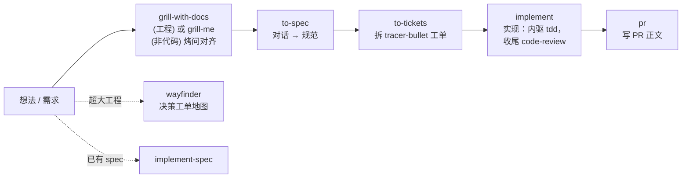
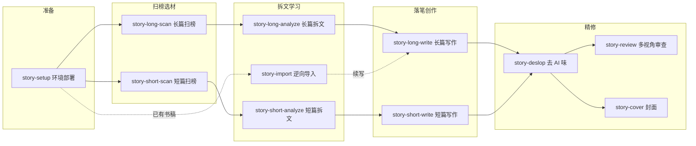

# Skills 工作区 · 技能路由

本工作区通过 [skills.sh](https://skills.sh)（`npx skills`）向 **OpenClaw** 安装了两个外部技能库，共 **51 个技能**，统一落盘在工作区根目录的 `skills/` 下，并由 `skills-lock.json` 记录来源与哈希。

本文档是对两个原仓库的解读与**技能路由表**：当你有一个意图时，应该触发哪个技能。技能可通过斜杠命令（`/技能名`，story 系列还支持 `$story`）显式调用，也可用自然语言描述意图由模型自动匹配。

| 技能源 | 定位 | 技能数 | 路由入口 |
|:-------|:-----|:------:|:---------|
| [mattpocock/skills](https://github.com/mattpocock/skills) | Skills For Real Engineers — 真实工程方法论（小而可组合，不接管流程） | 38 | `/ask-matt` |
| [zenstory-ai/oh-story-claudecode](https://github.com/zenstory-ai/oh-story-claudecode) | Oh Story — 中文网文写作全流程工具箱（扫榜 → 拆文 → 写作 → 去 AI 味） | 13 | `/story` |

---

## 一、mattpocock/skills 路由（工程线，38 个）

### 设计哲学：对症四个失败模式

原仓库将技能设计为对四个常见 Agent 失败模式的"解药"，理解这一点即可理解路由逻辑：

1. **Agent 没做我想要的** → 先"烤问"（grilling）对齐需求
2. **Agent 太啰嗦** → 建立 shared language（领域模型 / `CONTEXT.md`）
3. **代码跑不起来** → 反馈回路（TDD、诊断循环）
4. **代码变成泥球** → 深模块设计（deep modules）

### 首次使用

**每个仓库先跑一次** `/setup-matt-pocock-skills`：配置 issue tracker（GitHub / Linear / 本地文件）、triage 标签词表、领域文档布局。工程主线技能（`to-spec`、`to-tickets`、`implement`、`triage`、`wayfinder`）依赖这份配置。拿不准用哪个技能时，直接问路由入口 `/ask-matt`。

### 主工作流管线



### 场景路由表

调用方式列：**用户调用** = 只能你敲 `/命令` 触发（负责编排）；**模型调用** = 你可调用，模型在任务匹配时也会自动伸手（承载可复用的纪律）。用户调用技能可以调用模型调用技能，反之不行。

| 你的意图 | 触发技能 | 调用方式 | 说明 |
|:---------|:---------|:---------|:-----|
| 不知道该用哪个技能 | `ask-matt` | 用户 | 本仓库的官方路由器，描述处境即可 |
| 要改代码 / 做新功能，先对齐需求 | `grill-with-docs` | 用户 | 烤问 + 顺带沉淀 `CONTEXT.md` 术语表和 ADR |
| 非代码的计划 / 设计要磨清楚 | `grill-me` | 用户 | 纯烤问，不加文档 |
| 对话已经聊透了，落成规范 | `to-spec` | 用户 | 无访谈，直接综合成 spec 发到 issue tracker |
| 把计划 / spec 拆成工单 | `to-tickets` | 用户 | tracer-bullet 工单 + 阻塞依赖边 |
| 按 spec / 工单实现 | `implement` | 用户 | 驱动 `tdd`，收尾跑 `code-review` |
| 已有 spec 直接写代码 | `implement-spec` | 用户 | in-progress，纯实现 |
| 工程太大，一个会话装不下 | `wayfinder` | 用户 | 决策工单地图，逐个解锁 |
| 写 PR 描述 | `pr` | 用户 | PR 正文格式参照（模板优先） |
| 功能 / 修 bug 要测试先行 | `tdd` | 模型 | red-green-refactor 循环 |
| 东西坏了 / 抛错 / 变慢，难查 | `diagnosing-bugs` | 模型 | 诊断循环：复现 → 最小化 → 假设 → 插桩 → 修 → 回归测试 |
| 审查某个基点以来的改动 / PR | `code-review` | 模型 | 双轴并行子代理：Standards + Spec |
| codebase 越来越难改 | `improve-codebase-architecture` | 用户 | 扫描"深化"机会出 HTML 报告，选中后接着烤问（建议每几天跑一次） |
| 设计 / 改进模块接口、找接缝 | `codebase-design` | 模型 | deep module 设计词汇与纪律 |
| 统一项目黑话、写 ADR | `domain-modeling` | 模型 | 领域建模，维护术语表与 `CONTEXT.md` |
| TypeScript 仓库接入 dependency-cruiser | `setup-ts-deep-modules` | 用户 | in-progress |
| 调研一个问题（查权威一手资料） | `research` | 模型 | 后台代理，产出带引用的 Markdown 报告落库 |
| 用一次性原型回答设计疑问 | `prototype` | 模型 | 状态/逻辑用单 HTML；UI 出多个大相径庭的变体 |
| issue / 外部 PR 分诊 | `triage` | 用户 | 状态机分诊，产出 agent-ready brief |
| 解决进行中的 merge/rebase 冲突 | `resolving-merge-conflicts` | 模型 | 按意图逐 hunk 解决，绝不 `--abort` |
| 只有人类能做的步骤（配置密钥、控制台操作） | `wizard` | 模型 | 生成交互式 bash 向导带人走完 |
| 会话太长，换会话继续 | `handoff` / `claude-handoff` | 用户 | 压缩成交接文档 / 直接移交后台新代理 |
| 一条消息没听懂 | `wait-what` | 用户 | 让 Agent 用 `CONTEXT.md` 词汇重新讲一遍 |
| 决策需要别人填空 | `to-questionnaire` | 用户 | 把问题变成问卷发出去 |
| 教我一个新概念 | `teach` | 用户 | 多会话渐进式教学，当前目录作学习工作台 |
| 这次的会话复盘 | `retro` | 用户 | in-progress，编码会话回顾 |
| 给这个工作区造工作流的 spec | `loop-me` | 用户 | in-progress，对本工作区反复烤问 |
| 写文章（不是代码） | `writing-fragments` → `writing-shape` → `writing-beats` | 模型 | in-progress 写作三件套：挖素材 → 逐段成形 → 组装为 beat 旅程 |
| 写 / 改技能、AGENTS.md、CLAUDE.md | `writing-for-agents` | 模型 | 给 Agent 读的文档怎么写 |
| 加 pre-commit 钩子（Husky + lint-staged） | `setup-pre-commit` | 用户 | misc |
| 防危险 git 操作（push、reset --hard…） | `git-guardrails-claude-code` | 用户 | misc，Claude Code hooks |
| 测试里的 `as` 断言迁移 shoehorn | `migrate-to-shoehorn` | 用户 | misc |
| 搭课程练习目录骨架 | `scaffold-exercises` | 用户 | misc |

> misc 组技能在原仓库不被主线推广，仅在需要时取用；in-progress 组是公开实验田，随时可能变动。

---

## 二、zenstory-ai/oh-story-claudecode 路由（网文创作线，13 个）

### 定位

中文网文（长篇：起点 / 番茄 / 晋江 / 七猫 / 刺猬猫；短篇：知乎盐言 / 番茄短篇 / 七猫短篇）创作全流程。核心机制：**文件系统当记忆**（设定 / 大纲 / 正文 / 追踪分目录，`追踪/_tracking-state.json` 为唯一结构化权威）+ **7 个专业 Agent**（story-architect、narrative-writer、consistency-checker 等）+ **8 个自动化 hook**（仅"缺细纲不准写正文"一个阻断性）。

### 首次使用

**每个写作项目先跑一次** `/story-setup`：部署平台适配与 7 个专业 Agent（必须部署后**新开会话**才生效；升级版本后同样重跑 + 新开会话）。已有配置安全合并。

### 官方管线



> 已有方向的老作者可从 `story-long-write` / `story-short-write` 直接开写，跳过扫榜拆文。

### 核心五件套（写一本书够用）

| 你的意图 | 触发技能 | 触发方式 | 说明 |
|:---------|:---------|:---------|:-----|
| 准备写书 / 搭写作环境 | `story-setup` | `/story-setup` `$story-setup`、「准备写书」「帮我搭一下环境」 | 先跑一次；部署 7 Agent + hooks |
| 我想写小说（不确定走哪步） | `story` | `/story` `$story`、「我想写小说」 | **工具箱主路由**：模糊意图分发 + 作者习惯记忆 + 本地 Dashboard |
| 开书写长篇 / 日更 / 续写 / 改某章 | `story-long-write` | `/写长篇`、「帮我开书」「定设定」「出卷纲」「写大纲」「日更」「重写第X章」 | 大纲 → 卷纲 → 细纲 → 正文，守卫强制先细纲后正文 |
| 写短篇 | `story-short-write` | `/写短篇`、「帮我写一篇短篇」「写个盐言故事」 | 聚焦情绪拉扯与反转节奏 |
| 写完去 AI 味 | `story-deslop` | `/去AI味`、「这篇太AI了」 | 写作 lint：确定性清除 AI 句式 / 标点，目标读感 |

### 进阶技能

| 你的意图 | 触发技能 | 触发方式 | 说明 |
|:---------|:---------|:---------|:-----|
| 长篇什么火 / 看市场 | `story-long-scan` | `/长篇扫榜`、「长篇什么火」「起点排行」 | 起点 / 番茄 / 晋江榜单趋势 |
| 短篇什么火 | `story-short-scan` | `/短篇扫榜`、「短篇什么火」「知乎故事排行」 | 盐言 / 七猫等风口题材 |
| 拆解一本长篇对标书 | `story-long-analyze` | `/长篇拆文`、「帮我拆这本书」「分析黄金三章」 | 黄金三章 / 爽点 / 节奏 / 灵感库管道，支持断点续跑 |
| 拆解一篇爆款短篇 | `story-short-analyze` | `/短篇拆文`、「拆短篇」「分析这篇短篇」 | 故事核 / 反转设计 / 共鸣层次，产出喂给 `story-short-write` |
| 把已写的书导进来接着写 | `story-import` | `/导入小说`、「把我的书导进来」 | 逆向解析为标准项目结构，按篇幅自动分流长/短篇管道 |
| 多视角对抗审稿 | `story-review` | `/审查`、「帮我审一下」 | 4 Agent 多视角 + 平台评分标准；无 agent 时 solo 降级 |
| 做小说封面 | `story-cover` | `/封面`、「帮我做个封面」 | 题材分析 + GPT-Image-2 生成带书名署名封面 |
| 复用浏览器登录态抓数据 | `browser-cdp` | `/browser-cdp`、「浏览器操作」「复用登录态」 | CDP 协议操控 Chrome，为扫榜等抓取提供登录态 |

> `/story dashboard` 打开本地工作台（浏览 / 编辑拆文库与写作项目，仅监听 127.0.0.1）；「记住我的写作习惯」进入 `story` 的作者记忆。

---

## 三、跨仓库路由

两条技能线互相独立：**工程任务走 mattpocock，小说创作走 oh-story**。边界情形按下表分流：

| 场景 | 去哪条线 |
|:-----|:---------|
| 改代码、修 bug、发 PR、架构治理、issue 管理 | mattpocock 工程线 |
| 写 / 改 / 导入小说、拆书、扫榜、封面 | oh-story 创作线 |
| 非代码的计划（活动、产品、研究计划）要磨清楚 | mattpocock `grill-me` / `to-questionnaire` |
| 小说设定 / 大纲想被反复拷问压测 | oh-story `story-review`（成品审稿）为主，可在 `story-long-write` 只讨论结构阶段配合 mattpocock `grill-me` 口头对齐 |
| 通用资料调研（非平台榜单） | mattpocock `research`；平台榜单 / 风口数据走 oh-story 扫榜 |
| 会话交接、复盘 | mattpocock `handoff` / `claude-handoff` / `retro`（通用） |
| 给小说项目写 AGENTS.md / 自定义技能 | mattpocock `writing-for-agents` |

## 四、安装与更新

```bash
# 本次安装记录（OpenClaw 目标，全部技能）
npx skills add mattpocock/skills -s '*' -y -a openclaw
npx skills add zenstory-ai/oh-story-claudecode --skill '*' -y -a openclaw

# 后续拉取上游更新（skills 为普通文件，不会自动变更）
npx skills update
```

- 技能落盘：`skills/<技能名>/`（含 `SKILL.md`、`references/`、`scripts/` 等）
- 版本清单：`skills-lock.json`（记录来源仓库、`skillPath` 与哈希，升级前后可 diff）
- 工作区自有技能在 `.agents/skills/`，与本安装目录互不干扰

> 原仓库提醒：技能以完整 Agent 权限运行，使用前请审阅内容。
